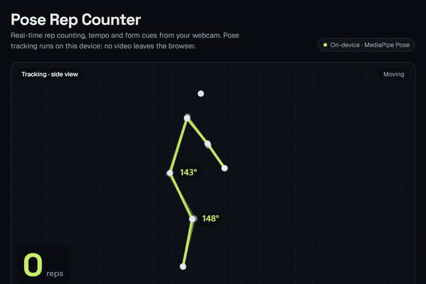
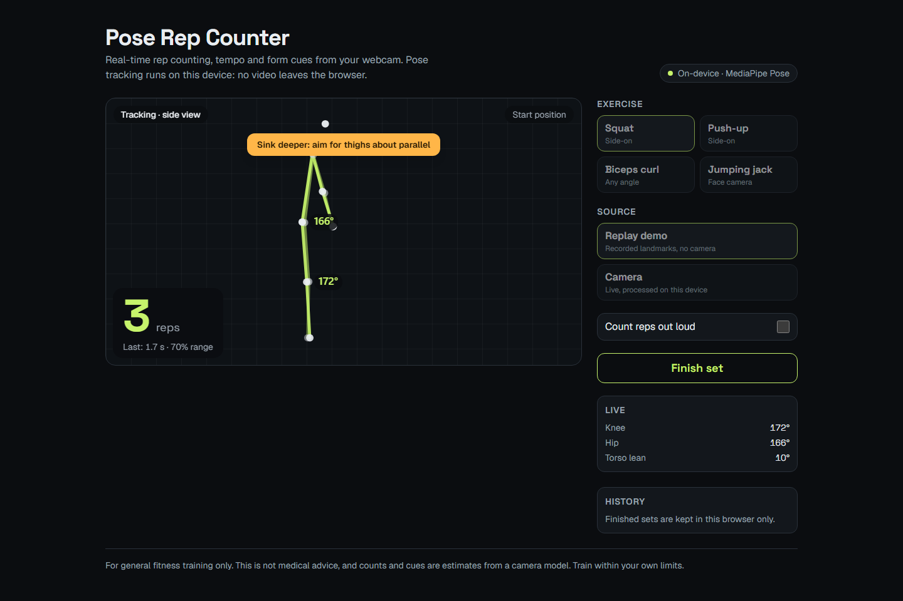
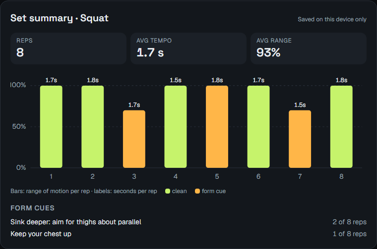
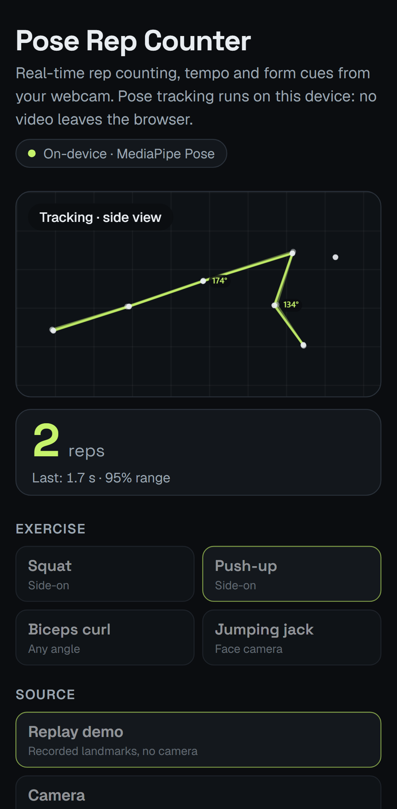
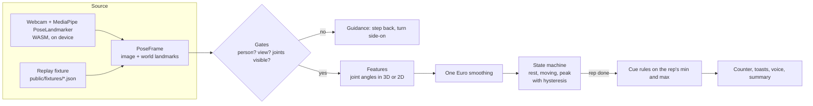

# Pose Rep Counter

Point your webcam at yourself, pick an exercise and train. The app tracks your body with MediaPipe Pose, counts reps, times each one, measures range of motion and gives short form cues. Everything runs in the browser: no video frame leaves your device.

> Em português: contador de repetições pela webcam, com dicas de execução, rodando 100% no navegador.



| Live set (desktop) | Set summary | Mobile |
| --- | --- | --- |
|  |  |  |

All images above come from **replay mode**, which plays recorded landmark sequences through the same engine as the camera. No camera was needed to make them, and none is needed to try the app.

## Features

- Squat, push-up, biceps curl and jumping jack
- Live skeleton overlay with joint angle labels on the side the camera sees best
- Big rep counter, last rep tempo and range of motion, optional spoken count (Web Speech API)
- Form cues as toasts, checked once per rep against declarative rules
- "Move into frame" and "turn side-on" guidance when tracking is not good enough to count
- Set summary with averages and a per-rep chart, history kept in `localStorage`
- Replay mode (`/?replay=squat&speed=2`) for demos, tests and screenshots

## Try it

```bash
npm ci
npm run dev           # http://localhost:3000, choose "Replay demo" or "Camera"
```

| Command | What it does |
| --- | --- |
| `npm test` | Vitest unit tests for angles, smoothing, framing, state machines, cues, fixtures, history |
| `npm run lint` / `npm run typecheck` / `npm run build` | The CI gates |
| `npm run e2e` | Playwright: plays every fixture in the real UI, desktop and mobile |
| `npm run fixtures` | Regenerates `public/fixtures/*.json` (deterministic seeds) |
| `npm run accuracy` | Prints the accuracy tables below |
| `npm run screenshots` | Rebuilds the images in `docs/` from replay mode (needs a server on port 3123 and ffmpeg) |

## How it works



The engine (`src/lib/exercises/rep-engine.ts`) is a plain function that takes one frame at a time. It has no timers and no DOM access, so the camera loop, the replay player, the unit tests and the accuracy script all drive the exact same code.

1. **Gates.** No person means "step into view". A side-view exercise filmed from the front asks you to turn side-on (the view is classified from shoulder width over torso length). Required joints below 0.5 visibility, or outside the frame, pause counting with a hint about the missing body part.
2. **Features.** Each exercise declares its features as small functions over a `Body` helper: `angle(hip, knee, ankle)`, `lean(hip, shoulder)`, `spread(ankle)`. World landmarks (metres, 3D) are used when available, so an angle does not shrink when a limb points at the camera. Image landmarks are the fallback, with x rescaled by the aspect ratio. Side-on exercises are measured on the nearer side, which only switches when the other side is clearly more visible.
3. **Smoothing.** A One Euro filter per feature: strong smoothing while you hold still, little lag when you move fast.
4. **State machine.** A rep starts when the primary angle leaves the `rest` threshold, reaches its far end past `peak`, and counts when it comes back past `rest`. The gap between the two thresholds is what stops jitter from counting twice. Half reps never reach `peak` and are ignored.
5. **Cues.** Rules are data, `{ feature, aggregate: "min" | "max", op, threshold, message }`, checked once per finished rep.

## Exercise rules

Angles are interior joint angles in degrees (180 is a straight limb). Every number lives in `src/lib/exercises/catalog.ts`.

| Exercise | Camera | Counted on | Rest / peak | Form cues |
| --- | --- | --- | --- | --- |
| Squat | side-on | knee (hip, knee, ankle) | 160° / 115° | min knee > 100°: "Sink deeper"; max torso lean > 45°: "Keep your chest up" |
| Push-up | side-on, floor level | elbow (shoulder, elbow, wrist) | 150° / 110° | min elbow > 100°: "Lower your chest"; min body line (shoulder, hip, ankle) < 160°: "Keep hips in line" |
| Biceps curl | any | elbow, nearest arm | 140° / 70° | min elbow > 60°: "Squeeze to the top"; max upper arm vs torso > 35°: "Keep your elbow tucked"; max torso lean > 15°: "No swinging" |
| Jumping jack | facing | arms (hip, shoulder, wrist), both sides | 45° / 120° | max arms < 150°: "Hands overhead"; max feet spread < 1.4 × shoulder width: "Feet wider" |

## Accuracy notes

There is no labelled video dataset in this repo, so these numbers come from **synthetic sets**: a kinematic stick figure performs each exercise (with deliberate faults and tracking gaps), is projected into a 16:9 frame, and gets Gaussian noise on every landmark. Real camera tracking is noisy in ways a simulation does not capture (occlusion, loose clothing, lighting), so read this as a test of the counting logic, not of MediaPipe.

Fixtures in `public/fixtures` (image noise σ = 0.003 of the frame, world noise 8 mm), from `npm run accuracy`:

| Fixture | Expected reps | 3D reps | 2D reps | Cues match (3D / 2D) |
| --- | --- | --- | --- | --- |
| squat-side | 8 | 8 | 8 | yes / yes |
| pushup-side | 6 | 6 | 6 | yes / yes |
| curl-side | 8 | 8 | 8 | yes / yes |
| jumping-jack-front | 10 | 10 | 10 | yes / yes |

Noise sweep on 2D image landmarks, 25 random sets per cell. Each cell is the share of sets with the exact rep count, smoothing on / off:

| Exercise | σ = 0.005 | σ = 0.01 | σ = 0.02 | σ = 0.03 | σ = 0.05 |
| --- | --- | --- | --- | --- | --- |
| squat | 100% / 100% | 100% / 100% | 100% / 0% | 36% / 0% | 0% / 0% |
| pushup | 100% / 100% | 100% / 100% | 100% / 16% | 48% / 0% | 0% / 0% |
| curl | 100% / 100% | 100% / 100% | 100% / 48% | 64% / 0% | 0% / 0% |
| jumping-jack | 100% / 100% | 100% / 100% | 100% / 100% | 100% / 100% | 100% / 96% |

What this says: counting is exact up to landmark jitter of 2% of the frame height, and the One Euro filter is what makes the 2% column work. Beyond that the failures are over-counts, where noise pushes a 2D angle across both thresholds. Jumping jacks hold up best because the arm swing (about 150°) is far wider than the noise. A unit test also shows that a naive single-threshold counter double counts on the same kind of data.

## Design decisions

- **Rules as data, engine as a pure function.** Adding an exercise means a config object and, optionally, a simulator model. Thresholds are reviewed in one file and the engine does not change.
- **3D first, 2D fallback.** World landmarks keep angles independent of where the camera stands. The 2D path stays, tested on the same fixtures and corrected for aspect ratio.
- **Hysteresis on the angle.** A band on the signal itself is simple to reason about and to test. Exact counts on fixtures and explicit jitter tests guard it.
- **Synthetic fixtures instead of recorded video.** They are small (only the 13 landmarks the engine reads), deterministic, free of personal data, and they carry ground truth, so tests assert exact counts and cues.
- **Lazy model loading.** MediaPipe and the model load only when you start a camera set; replay mode never downloads them.
- **Small UI surface.** One client component owns the session. The canvas is drawn imperatively on every frame while React re-renders at most ten times per second.

## Privacy

Video stays on your device. The page downloads the MediaPipe WASM runtime (jsDelivr) and the `pose_landmarker_lite` model (Google storage) once, then runs inference locally. Frames, landmarks and results are never uploaded. Finished sets are saved in your browser's `localStorage` and can be cleared from the History panel. There is no analytics and no backend.

## Disclaimer

This is a training aid for general fitness. It is not medical advice and it does not assess health or safety. Rep counts and form cues are estimates from a camera model and can be wrong. Train within your own limits.

## Stack

Next.js 16 (App Router), React 19, TypeScript (strict), Tailwind CSS 4, MediaPipe Tasks Vision 1.1.0, Vitest, Playwright, GitHub Actions.

## License

MIT © 2026 Leonardo Carnevalli
